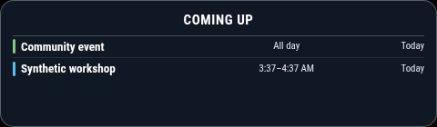

# MMM-UpcomingCards

Upcoming calendar events and optional birthday countdown cards.

Version 0.1.0. MIT-licensed standalone MagicMirror module.



## Installation

From your MagicMirror installation directory:

```sh
cd modules
git clone https://github.com/QuietNodeLab/MMM-UpcomingCards.git
```

Alternatively, download the repository ZIP and extract it as the folder below.

Copy this folder into `MagicMirror/modules/MMM-UpcomingCards`. No extra npm
runtime packages or shared dashboard stylesheet are required. Use MagicMirror
2.38.0 with Node 24 as the tested baseline; other versions still need
verification.

For birthdays mode only, copy `birthdays.example.json` to
`MagicMirror/config/birthdays.json`. Keep real data private and outside Git.

Add a module entry to your local config:

```js
{
  module: "MMM-UpcomingCards",
  position: "top_left",
  config: {
    "mode": "comingup",
    "timezone": "America/New_York",
    "maximumEntries": 3
  }
}
```

## Behavior and configuration

Coming Up listens to `CALENDAR_EVENTS`, normally broadcast by MagicMirror's
default calendar. Add a separate `calendar` module configured with your own
local/private feeds; the coming-up card itself does not fetch feeds.
`broadcastPastEvents: true` allows ongoing events that began on previous dates.
Use a compatible calendar broadcaster. No MonthlyCalendar installation or patch
is needed by end users.

The broadcaster's server timezone, intended calendar zone and display should
agree for floating ICS VALUE=DATE entries. For the New York example, start a
development server with `TZ=America/New_York node ./serveronly`; in PowerShell
set `$env:TZ = 'America/New_York'` before startup, or supply Docker
`--env TZ=America/New_York` / Compose `environment: { TZ: America/New_York }`.
Change all three together for another zone. Do not reconfigure a production
device as part of testing.

Options: `mode` (comingup or birthdays), `timezone` (null = browser zone),
`title` (null = mode heading), `maximumEntries` (3), `maximumNumberOfDays` (5),
`birthdayFile` (birthdays.json), `maxShown` (3 birthdays). In birthdays mode,
copy the example JSON into config; the helper and date logic are bundled. No
birthday module is required.

Events are copied deeply before storing. Ongoing events stay visible through
their final day. ICS all-day ends are exclusive, unlike inclusive event ranges
in some countdown modules. Start-time ordering, deduplication and limits are
preserved. No custom CSS classes or dashboard grid are required.


For the real ingestion/DST regression, prepare the exact runtime and
MonthlyCalendar listed in runtime-pins.json, with runtime development
dependencies and Chromium. Apply the bundled
tests/integration/fixtures/MMM-MonthlyCalendar.patch to that disposable
MonthlyCalendar checkout; preserve the adjacent upstream MIT license. Then run
`MM_RUNTIME_PATH=/path/to/runtime MM_BROWSER_EXECUTABLE=/path/to/chromium npm run test:calendar-integration`.
On PowerShell set those environment variables before running npm.
MonthlyCalendar is a test interaction partner, not an end-user dependency. The
tests fetch only bundled synthetic fixtures.

## Synthetic data example

```json
{
  "people": [
    {
      "name": "Sample Person",
      "date": "2000-02-28",
      "note": "Have a wonderful day!"
    }
  ]
}
```

## Development

`npm ci --ignore-scripts` and `npm test` run offline with Node 24. External APIs
must be mocked. JSON date modules use calendar dates; the configured zone
selects "today". Private configuration and cache data are ignored. All example
people, locations and events are synthetic or public examples. Screenshots use
only mock data.

Styles are scoped to the module. Change its own card CSS in your local
custom.css if desired; do not copy a full dashboard theme. Keep filenames as
filenames rather than absolute deployment paths. JSON helpers search config
first, then the module. Timers stop when the module is suspended and restart
when it resumes.

See [VALIDATION.md](VALIDATION.md) for tests actually performed and their
limits.

## License and attribution

The custom package code is MIT-licensed under module contributors; see
[LICENSE](LICENSE). No source-project Git history, private configuration,
optional device services or upstream module runtime implementation is bundled. A
separately licensed upstream patch is included only as an integration-test
fixture. MagicMirror is a separate dependency. See
[ATTRIBUTION.md](ATTRIBUTION.md) for artwork and external data notes.
